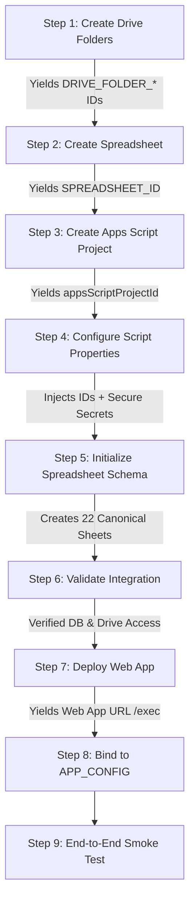

# STEP 04A: Google Workspace Infrastructure Setup Plan & Inventory

**Target Project:** `C:\Users\pc\Documents\APP\Mubarokah_App`  
**Source Project:** `C:\Users\pc\Documents\APP\asnawiyyah` (Read-Only, Untouched)  
**Status:** **PLAN & INVENTORY ONLY — DO NOT PROVISION YET**

---

## 1. Objective

To establish an authoritative, fully validated provisioning plan for a brand-new, completely isolated Google Workspace infrastructure for **Mubarokah App**. 

The planned infrastructure consists of:
1. A clean, dedicated **Google Spreadsheet** containing all **22 authoritative canonical and academic extension sheets** with exact column schemas extracted directly from code evidence.
2. A dedicated **Google Drive folder hierarchy** for public portal media, student photos, and staff photos.
3. A standalone **Google Apps Script project** adapted from `legacy/Code.gs` with all tenant bindings and hardcoded secrets removed.
4. A secure **Script Properties configuration boundary** isolating backend secrets from frontend visibility.
5. A future **Web App deployment** with Founder security review gate and **APP_CONFIG integration contract**.

---

## 2. Safety Constraints & Non-Negotiable Rules

1. **Zero External Mutation:** No Google Spreadsheet, Google Drive folder, Google Apps Script project, or Google Cloud OAuth client will be created, modified, or provisioned during this planning phase.
2. **Zero PII or Seed Data Transfer:** No real or mock student records, employee data, wali/parent records, alumni entries, tahfidz logs, or institutional photos from ASNawiyyah will be transferred or seeded.
3. **Zero Resource ID Reuse:** Under no circumstances will any Google Drive ID (`1xKMwCsHJ9...`, `15N2sd_Etm...`, `1XJi_lcDly...`), Apps Script ID, Spreadsheet ID, or Vercel ID from ASNawiyyah be referenced or reused.
4. **Source Untouched:** The source repository `C:\Users\pc\Documents\APP\asnawiyyah` remains strictly read-only.
5. **Zero Secret Hardcoding & Privacy Rule:** No plaintext Admin PIN, HMAC secrets, salts, tokens, or OAuth secrets will ever be placed in source code, markdown plans, reports, logs, Git history, or `js/app-config.js`. The Founder will **never** be asked to share or paste plaintext credentials into the agent interface.
6. **Zero Plaintext Admin PIN:** The Founder will generate the `ADMIN_PIN_HASH` offline and enter it directly into Google Apps Script Script Properties.

---

## 3. Google Spreadsheet Plan (22 Authoritative Sheets)

### 3.1. Proposed Spreadsheet Identity
* **Proposed Spreadsheet Name:** `Mubarokah App Database [OFFICIAL]`
* **Owner Account:** Mubarokah Official Institution / Google Workspace Admin Account (Founder to confirm).

### 3.2. Authoritative Sheet Inventory (Exactly 22 Sheets)
A rigorous code audit of `legacy/Code.gs` confirms that the application architecture requires **exactly 22 distinct sheets** across 5 functional domains.

*(Note on Deprecated Sheets: The legacy constant `SHEET_OTP = "OTP_Cache"` found in early codebase iterations is deprecated and superseded by `OTP_Challenges`. `OTP_Cache` will **NOT** be provisioned in Mubarokah).*

```text
Mubarokah App Database (22 Sheets Total)
├── Domain I: Public & Portal CMS (7 Sheets)
│   ├── 1. Pendaftar
│   ├── 2. Berita
│   ├── 3. Banner
│   ├── 4. Galeri
│   ├── 5. Unit_Kegiatan
│   ├── 6. Notifikasi
│   └── 7. Pengaturan
├── Domain II: Alumni Relations (1 Sheet)
│   └── 8. Data_Alumni
├── Domain III: Identity, RBAC & Authentication - Phase 2B (9 Sheets)
│   ├── 9. Users
│   ├── 10. Admin_Identities
│   ├── 11. Wali_Identities
│   ├── 12. Pengasuh_Identities
│   ├── 13. Students
│   ├── 14. Wali_Santri_Map
│   ├── 15. OTP_Challenges
│   ├── 16. Auth_Sessions
│   └── 17. Auth_Audit_Log
├── Domain IV: Tahfidz Academic Engine (4 Sheets)
│   ├── 18. Tahfidz_Logs
│   ├── 19. Tahfidz_Target
│   ├── 20. Tahfidz_Halaqah
│   └── 21. Tahfidz_Jadwal_Sesi
└── Domain V: Personnel & Human Resources (1 Sheet)
    └── 22. Pegawai
```

---

### 3.3. Authoritative Schema Matrix (Extracted from Code.gs Evidence)

| # | Sheet Name | Exact Header Names & Order | Primary Key | Required vs Optional Fields | Source Code Evidence (Function & Line) | PII Classification | Operational Purpose | Schema Confidence |
| :-: | :--- | :--- | :--- | :--- | :--- | :---: | :--- | :---: |
| **1** | **Pendaftar** | **Order (7 cols):**<br>Col 1: `Timestamp`<br>Col 2: `Nama Lengkap`<br>Col 3: `NISN`<br>Col 4: `Nama Wali`<br>Col 5: `WhatsApp`<br>Col 6: `Program Pilihan`<br>Col 7: `Status`<br>*(Row 1 string headers pending confirmation)* | `NISN` (Col 3) | **Req:** `nama`, `nisn`, `whatsapp`, `program`<br>**Opt:** `wali` | `submitPendaftaran` (L712-755), `checkStatusPendaftar` (L639-674), `getPendaftarData` (L768-795) | **HIGH** | Online PPDB student admissions registry | **PARTIAL**<br>*(Positions 1-7 confirmed in code; exact row 1 header string text is `__SCHEMA_CONFIRMATION_PENDING__`)* |
| **2** | **Berita** | `news_id`, `slug`, `Tanggal`, `Judul`, `Kategori`, `Penulis`, `Gambar_URL`, `Ringkasan`, `Isi` | `news_id` | **Req:** `news_id`, `slug`, `Judul`, `Kategori`, `Penulis`, `Ringkasan`, `Isi`<br>**Opt:** `Gambar_URL` | `simpanBerita` (L1010-1031), `migrateBeritaSheetToIdentityV2` (L902-926), `getBeritaData` (L840-880) | **NONE** | Portal news, press releases, and articles | **CONFIRMED** |
| **3** | **Banner** | `ID_Banner`, `Nama_Banner`, `Gambar_URL`, `Tipe_Aksi`, `Target_Aksi`, `Urutan`, `Status` | `ID_Banner` | **Req:** `ID_Banner`, `Nama_Banner`, `Gambar_URL`, `Urutan`, `Status`<br>**Opt:** `Tipe_Aksi`, `Target_Aksi` | `getBannerData` (L1391), `simpanBanner` (L1435-1460) | **NONE** | Homepage carousel & promo banners | **CONFIRMED** |
| **4** | **Galeri** | `ID_Galeri`, `Judul`, `Kategori`, `Keterangan`, `Gambar_URL`, `Status`, `Timestamp` | `ID_Galeri` | **Req:** `ID_Galeri`, `Judul`, `Kategori`, `Gambar_URL`, `Status`<br>**Opt:** `Keterangan`, `Timestamp` | `getGaleriData` (L1545), `simpanGaleri` (L1589-1615) | **NONE** | Institution photo gallery & media events | **CONFIRMED** |
| **5** | **Unit_Kegiatan** | `ID_Kegiatan`, `Nama`, `Kategori`, `Jadwal`, `Deskripsi`, `Gambar_URL`, `Urutan`, `Status`, `Timestamp` | `ID_Kegiatan` | **Req:** `ID_Kegiatan`, `Nama`, `Kategori`, `Status`<br>**Opt:** `Jadwal`, `Deskripsi`, `Gambar_URL`, `Urutan`, `Timestamp` | `getUnitKegiatanData` (L1803), `simpanUnitKegiatan` (L1902-1925) | **NONE** | Extracurricular santri activities (UKS) | **CONFIRMED** |
| **6** | **Notifikasi** | `ID`, `Judul`, `Kategori`, `Tanggal`, `Ringkasan`, `Isi`, `Gambar_URL`, `Is_Popup`, `Status`, `CreatedAt` | `ID` | **Req:** `ID`, `Judul`, `Kategori`, `Isi`, `Status`<br>**Opt:** `Tanggal`, `Ringkasan`, `Gambar_URL`, `Is_Popup`, `CreatedAt` | `getNotifikasiSheet` (L2014-2015), `simpanNotifikasi` (L2065-2095) | **NONE** | Broadcast push notifications & homepage pop-up announcements | **CONFIRMED** |
| **7** | **Pengaturan** | `Key`, `Value`, `Keterangan`, `Update_Terakhir` | `Key` | **Req:** `Key`, `Value`<br>**Opt:** `Keterangan`, `Update_Terakhir` | `getPengaturanData` (L1719), `simpanPengaturan` (L1754-1775) | **NONE** | Key-Value institutional parameters (video, profile, social links) | **CONFIRMED** |
| **8** | **Data_Alumni** | `Timestamp`, `Nama Lengkap`, `Jenis Kelamin`, `No WhatsApp`, `Media Sosial`, `Tahun Masuk`, `Tahun Lulus`, `Program Terakhir`, `Kesibukan`, `Instansi/Perusahaan`, `Kesan & Pesan`, `Provinsi`, `Kabupaten`, `Kecamatan`, `Desa/Kelurahan`, `Alamat Lengkap`, `Latitude`, `Longitude`, `Foto`, `Izin Publikasi` | `No WhatsApp` / Timestamp | **Req:** `Nama Lengkap`, `Jenis Kelamin`, `No WhatsApp`, `Tahun Lulus`, `Izin Publikasi`<br>**Opt:** Remaining fields | `saveAlumniData` (L4165-4170), `getAlumniData` (L4235-4265) | **HIGH** | Alumni directory & tracer study with geo-coordinates | **CONFIRMED** |
| **9** | **Users** | `user_id`, `email`, `phone`, `name`, `role`, `photo_url`, `status`, `created_at`, `last_login_at` | `user_id` | **Req:** `user_id`, `name`, `role`, `status`, `created_at`<br>**Opt:** `email`, `phone`, `photo_url`, `last_login_at` | `AUTH_SHEET_SCHEMAS[SHEET_USERS]` (L4546), `setupAuthSystemSheets` (L4568-4600) | **HIGH** | Unified core user accounts and identity baseline | **CONFIRMED** |
| **10** | **Admin_Identities** | `identity_id`, `email`, `name`, `role`, `status`, `created_at`, `photo_url` | `identity_id` | **Req:** `identity_id`, `email`, `name`, `role`, `status`, `created_at`<br>**Opt:** `photo_url` | `AUTH_SHEET_SCHEMAS[SHEET_ADMIN_IDENTITIES]` (L4547), `getAdminIdentityByEmail` (L5230-5250) | **HIGH** | Administrative identity and RBAC role assignments | **CONFIRMED** |
| **11** | **Wali_Identities** | `identity_id`, `email`, `phone`, `name`, `role`, `status`, `created_at`, `photo_url` | `identity_id` | **Req:** `identity_id`, `name`, `role`, `status`, `created_at`<br>**Opt:** `email`, `phone`, `photo_url` | `AUTH_SHEET_SCHEMAS[SHEET_WALI_IDENTITIES]` (L4548), `findWaliIdentityByIdentifier` (L5300-5325) | **HIGH** | Guardian identity records for student monitoring | **CONFIRMED** |
| **12** | **Pengasuh_Identities** | `identity_id`, `email`, `phone`, `title_name`, `role`, `status`, `created_at`, `photo_url` | `identity_id` | **Req:** `identity_id`, `title_name`, `role`, `status`, `created_at`<br>**Opt:** `email`, `phone`, `photo_url` | `AUTH_SHEET_SCHEMAS[SHEET_PENGASUH_IDENTITIES]` (L4549), `getPengasuhIdentityById` (L5350-5370) | **HIGH** | Institutional leadership and kyai/pengasuh accounts | **CONFIRMED** |
| **13** | **Students** | `student_id`, `nis`, `nik`, `name`, `gender`, `birth_date`, `photo_url`, `program`, `status`, `created_at`, `qr_code` | `student_id` | **Req:** `student_id`, `nis`, `name`, `gender`, `program`, `status`, `created_at`<br>**Opt:** `nik`, `birth_date`, `photo_url`, `qr_code` | `AUTH_SHEET_SCHEMAS[SHEET_STUDENTS]` (L4550), `getStudentById` (L5400-5420) | **HIGH** | Official santri academic registry | **CONFIRMED** |
| **14** | **Wali_Santri_Map** | `map_id`, `wali_id`, `student_id`, `relationship`, `status`, `created_at` | `map_id` | **Req:** `map_id`, `wali_id`, `student_id`, `relationship`, `status`, `created_at`<br>**Opt:** None | `AUTH_SHEET_SCHEMAS[SHEET_WALI_SANTRI_MAP]` (L4551), `getStudentsForWali` (L5450-5475) | **MODERATE** | Relational mapping between guardians and santri | **CONFIRMED** |
| **15** | **OTP_Challenges** | `challenge_id`, `identity_id`, `channel`, `identifier_hash`, `otp_hash`, `attempts`, `max_attempts`, `expires_at`, `status`, `created_at`, `consumed_at`, `request_id` | `challenge_id` | **Req:** `challenge_id`, `identity_id`, `channel`, `identifier_hash`, `otp_hash`, `attempts`, `max_attempts`, `expires_at`, `status`, `created_at`<br>**Opt:** `consumed_at`, `request_id` | `AUTH_SHEET_SCHEMAS[SHEET_OTP_CHALLENGES]` (L4552), `createOtpChallenge` (L7400-7450) | **MODERATE** (Hashed) | Ephemeral OTP transaction verification with rate limiting | **CONFIRMED** |
| **16** | **Auth_Sessions** | `session_id`, `identity_id`, `role`, `issued_at`, `expires_at`, `status`, `revoked_at`, `created_at`, `token_version` | `session_id` | **Req:** `session_id`, `identity_id`, `role`, `issued_at`, `expires_at`, `status`, `created_at`, `token_version`<br>**Opt:** `revoked_at` | `AUTH_SHEET_SCHEMAS[SHEET_AUTH_SESSIONS]` (L4553), `createAuthSessionRecord` (L6890-6920) | **LOW** (Transient) | Stateful authentication session tracking & revoking | **CONFIRMED** |
| **17** | **Auth_Audit_Log** | `event_id`, `timestamp`, `event_type`, `identity_id`, `session_id`, `channel`, `success`, `request_id`, `metadata` | `event_id` | **Req:** `event_id`, `timestamp`, `event_type`, `success`<br>**Opt:** `identity_id`, `session_id`, `channel`, `request_id`, `metadata` | `AUTH_SHEET_SCHEMAS[SHEET_AUTH_AUDIT_LOG]` (L4554), `logAuthAuditEvent` (L4920-4960) | **LOW** (Technical) | Security audit trail for logins, OTPs, and permission checks | **CONFIRMED** |
| **18** | **Tahfidz_Logs** | `log_id`, `student_id`, `nis`, `student_name`, `gender`, `tanggal`, `sesi`, `tipe`, `juz`, `surah`, `halaman_list`, `total_halaman`, `nilai`, `muhafiz`, `catatan`, `created_at` | `log_id` | **Req:** `log_id`, `student_id`, `tanggal`, `sesi`, `tipe`, `juz`, `total_halaman`, `muhafiz`, `created_at`<br>**Opt:** `surah`, `halaman_list`, `nilai`, `catatan` | `initTahfidzSheets` (L8380-8384), `saveTahfidzLog` (L8550-8600) | **HIGH** | Daily ziyadah and muraja'ah recitation entries | **CONFIRMED** |
| **19** | **Tahfidz_Target** | `student_id`, `student_name`, `target_ziyadah_sesi`, `target_ziyadah_pekan`, `target_murajaah_sesi`, `target_murajaah_pekan`, `target_juz`, `updated_at` | `student_id` | **Req:** `student_id`, `target_juz`, `updated_at`<br>**Opt:** `student_name`, `target_ziyadah_*`, `target_murajaah_*` | `initTahfidzSheets` (L8400-8402), `getTahfidzTarget` (L8700-8730) | **HIGH** | Individual memorization target quotas | **CONFIRMED** |
| **20** | **Tahfidz_Halaqah** | `halaqah_id`, `nama_halaqah`, `kategori`, `muhafiz`, `target_kurikulum`, `student_ids`, `created_at` | `halaqah_id` | **Req:** `halaqah_id`, `nama_halaqah`, `kategori`, `muhafiz`, `created_at`<br>**Opt:** `target_kurikulum`, `student_ids` | `initTahfidzSheets` (L8418-8420), `getHalaqahList` (L8800-8830) | **MODERATE** | Study group divisions, assigned mentors, and member lists | **CONFIRMED** |
| **21** | **Tahfidz_Jadwal_Sesi** | `sesi_id`, `nama_sesi`, `jenis_sesi`, `status`, `jam_mulai`, `jam_selesai`, `hari_list`, `created_at` | `sesi_id` | **Req:** `sesi_id`, `nama_sesi`, `jenis_sesi`, `status`, `jam_mulai`, `jam_selesai`, `created_at`<br>**Opt:** `hari_list` | `initTahfidzSheets` (L8436-8438), `getJadwalSesi` (L8900-8930) | **NONE** | Operational timetable for daily recitation sessions | **CONFIRMED** |
| **22** | **Pegawai** | `employee_id`, `nama`, `nip`, `gender`, `jabatan`, `spesialisasi`, `telepon`, `email`, `status`, `created_at` | `employee_id` | **Req:** `employee_id`, `nama`, `jabatan`, `status`, `created_at`<br>**Opt:** `nip`, `gender`, `spesialisasi`, `telepon`, `email` | `getOrCreatePegawaiSheet` (L9726-9728), `getAllEmployeesData` (L9745-9770) | **HIGH** | Official faculty, asatidz, and institutional staff directory | **CONFIRMED** |

---

## 4. Google Drive Hierarchy Plan

All application upload destinations must reside within a single designated institution container.

```text
Mubarokah App/ [Root Container]
├── Media/ [Application-Managed Public Assets (Berita, Banner, Galeri, Unit Kegiatan, Notifikasi, Pengaturan)]
├── User Photos/ [Application-Managed Staff, Pengasuh, Admin, Wali Avatars]
└── Student Photos/ [Application-Managed Santri Photos & Student Cards]
```

### 4.1. Reconciliation of UKS Subfolder
* **Code Evidence:** In `legacy/Code.gs` (L1912), the function `simpanUnitKegiatan` creates files directly in the root media folder via `folder = DriveApp.getFolderById(FOLDER_ID)`. No dedicated `UKS/` folder or subfolder is created, queried, or referenced anywhere in the backend logic.
* **Resolution:** In strict accordance with application logic, **no dedicated `UKS/` subfolder will be provisioned**. Unit Kegiatan media is handled uniformly alongside other portal media inside the `Media/` folder (`DRIVE_FOLDER_ID`).

### 4.2. Folder Specification Matrix

| Folder Name | Drive Purpose | Application Usage | Contains PII? | Serving & Access Expectation | Backend Access Mechanism | Script Property Key | Application Evidence in Code.gs |
| :--- | :--- | :--- | :---: | :--- | :--- | :--- | :--- |
| **Mubarokah App/** | Top-level workspace container | Parent folder holding Spreadsheet and subfolders | Aggregated | Restricted; internal Workspace Admin only | Container navigation | `__MUBAROKAH_CONFIG_PENDING__` | Workspace root architecture |
| **Media/** | General portal public assets | Uploads for Berita, Banner, Galeri, Unit Kegiatan, Notifikasi, Pengaturan logo, Alumni photo | **LOW** (General media + alumni profile photo) | Application-managed media storage; public/private serving mechanism will be determined during backend implementation. | `DriveApp.getFolderById(FOLDER_ID).createFile(blob)` | `DRIVE_FOLDER_ID` | L993 (`simpanBerita`), L1445 (`simpanBanner`), L1599 (`simpanGaleri`), L1912 (`simpanUnitKegiatan`), L2074 (`simpanNotifikasi`), L2231 (`simpanPengaturan`), L4187 (`saveAlumniData`) |
| **User Photos/** | Identity profile pictures | Uploads for Asatidz, Pengasuh, Admin, and Wali avatars | **HIGH** (Personnel and guardian photographs) | Application-managed media storage; public/private serving mechanism will be determined during backend implementation. | `DriveApp.getFolderById(FOLDER_ID_USER_PHOTOS).createFile(blob)` | `DRIVE_FOLDER_USER_PHOTOS` | L5910 (`uploadUserPhotoToDrive`), L4535 |
| **Student Photos/** | Santri profile pictures | Uploads for student identification and student card images | **HIGH** (Minor student photographs) | Application-managed media storage; public/private serving mechanism will be determined during backend implementation. | `DriveApp.getFolderById(FOLDER_ID_STUDENT_PHOTOS).createFile(blob)` | `DRIVE_FOLDER_STUDENT_PHOTOS` | L5763 (`uploadStudentPhotoToDrive`), L5692 |

---

## 5. Google Apps Script Project Plan

### 5.1. Project Overview
* **Proposed Project Name:** `Mubarokah_Backend_API`
* **Source Files to Transfer:**
  * `legacy/Code.gs` (Contains full backend logic, routing, auth, and API handlers)
  * `legacy/appsscript.json` (Manifest declaring runtime version V8 and execution requirements)

### 5.2. Logic Transfer & Adaptation Strategy
1. **Preserved Logic:**
   * Full REST API dispatcher (`doPost`, `doGet`)
   * Dual-route authentication architecture (Phase 2B + Legacy adapter)
   * Tahfidz management, recording, target tracking, and progress aggregation
   * Dynamic banner, news, photo gallery, and UKS CMS
   * PPDB registration and status checking
   * Pegawai directory management
   * Rate limiting, OTP throttling, and audit logging
2. **Removed / Neutralized Logic:**
   * Zero hardcoded legacy URLs
   * Zero hardcoded Drive folder IDs
   * Zero hardcoded fallback secrets (`ASNAWIYYAH_*` removed; fallback PIN `123456` removed)
   * Neutralized email notification copy and seed records
3. **Spreadsheet & Drive Binding Strategy:**
   * Script is bound dynamically via `SpreadsheetApp.openById(props.getProperty("SPREADSHEET_ID"))` with container-bound fallback (`SpreadsheetApp.getActiveSpreadsheet()`).
   * Upload folders accessed dynamically via `DriveApp.getFolderById(props.getProperty("DRIVE_FOLDER_*"))`.
4. **Execution Permissions & Services:**
   * `SpreadsheetApp` (Read/Write tabular database)
   * `DriveApp` (File creation and URL generation)
   * `MailApp` / `GmailApp` (Transactional email verification and notifications)
   * `LockService` (Concurrency control for sequential IDs and atomic writes)
   * `Utilities` (Base64 encoding, SHA-256 digests, HMAC-SHA256 token signatures)
   * `PropertiesService` (Encapsulated secret and infrastructure storage)

---

## 6. Script Properties / Secret Configuration Plan

All environment secrets and infrastructure IDs must be set in Google Apps Script via:  
`Project Settings > Script Properties`.

| Category | Property Key | Purpose | Sensitivity | Required? | Consumption Location | Frontend Visible? |
| :--- | :--- | :--- | :---: | :---: | :--- | :---: |
| **Infrastructure** | `SPREADSHEET_ID` | Google Spreadsheet database ID | High | **YES** | `getDatabaseSpreadsheet()` in `Code.gs` | **NEVER** |
| **Infrastructure** | `DRIVE_FOLDER_ID` | Root CMS upload folder ID | Medium | **YES** | `simpanBerita`, `simpanBanner`, `simpanGaleri`, `simpanUnitKegiatan`, etc. | **NEVER** |
| **Infrastructure** | `DRIVE_FOLDER_USER_PHOTOS` | Staff/Wali photo upload folder ID | High | **YES** | `uploadUserPhotoToDrive` in `Code.gs` | **NEVER** |
| **Infrastructure** | `DRIVE_FOLDER_STUDENT_PHOTOS` | Santri photo upload folder ID | High | **YES** | `uploadStudentPhotoToDrive` in `Code.gs` | **NEVER** |
| **Authentication** | `AUTH_TOKEN_SIGNING_SECRET` | Primary HMAC-SHA256 signing secret for Phase 2B sessions | **CRITICAL** | **YES** | `generateSessionToken`, `verifySessionToken` | **NEVER** |
| **Authentication** | `TOKEN_SIGNING_SECRET` | Fallback / legacy HMAC-SHA256 signing secret | **CRITICAL** | **YES** | `getServerSecret`, `verifySessionToken` | **NEVER** |
| **Authentication** | `OTP_HASH_SECRET` | Cryptographic salt for OTP verification | **CRITICAL** | **YES** | `hashOtpCode` in `Code.gs` | **NEVER** |
| **Authentication** | `IDENTIFIER_HASH_SECRET` | Cryptographic salt for phone/email index hashing | **CRITICAL** | **YES** | `hashIdentifier` in `Code.gs` | **NEVER** |
| **Authentication** | `PASSWORD_SALT` | Cryptographic salt for user password hashing | **CRITICAL** | **YES** | `hashPassword` in `Code.gs` | **NEVER** |
| **Authentication** | `ADMIN_PIN_HASH` | Base64-encoded SHA-256 hash of admin master PIN | **CRITICAL** | **YES** | `admin.login` handler in `Code.gs` | **NEVER** |
| **Integration** | `WA_GATEWAY_URL` | Endpoint for WhatsApp OTP delivery gateway | Medium | Optional | `sendWhatsAppOtpMessage` in `Code.gs` | **NEVER** |
| **Integration** | `WA_GATEWAY_API_KEY` | Bearer token for WhatsApp gateway | **CRITICAL** | Optional | `sendWhatsAppOtpMessage` in `Code.gs` | **NEVER** |

---

## 7. `APP_CONFIG` Binding Plan

Once the infrastructure is provisioned, public non-secret pointers will be populated into `js/app-config.js`:

```javascript
// Mapping of future provisioned resources to js/app-config.js:
APP_CONFIG.infrastructure.appsScriptWebAppUrl = "https://script.google.com/macros/s/<NEW_DEPLOYMENT_ID>/exec";
APP_CONFIG.infrastructure.appsScriptProjectId = "<NEW_PROJECT_ID>";
APP_CONFIG.infrastructure.spreadsheetId       = "<NEW_SPREADSHEET_ID>";
APP_CONFIG.infrastructure.driveRootFolderId   = "<NEW_DRIVE_FOLDER_ID>";
APP_CONFIG.infrastructure.driveStudentFolderId= "<NEW_STUDENT_FOLDER_ID>";
APP_CONFIG.infrastructure.driveEmployeeFolderId= "<NEW_USER_FOLDER_ID>";

APP_CONFIG.authentication.authApiUrl          = "https://script.google.com/macros/s/<NEW_DEPLOYMENT_ID>/exec";
APP_CONFIG.authentication.googleClientId      = "<NEW_GOOGLE_CLIENT_ID>.apps.googleusercontent.com";
```

> [!CAUTION]
> **Strict Isolation Rule:** `AUTH_TOKEN_SIGNING_SECRET`, `PASSWORD_SALT`, `OTP_HASH_SECRET`, `IDENTIFIER_HASH_SECRET`, and `ADMIN_PIN_HASH` will **NEVER** be placed in `app-config.js` or frontend files.

---

## 8. Authoritative Provisioning Dependency Sequence (9 Steps)

To ensure absolute integrity and prevent circular dependency errors, provisioning must occur in this exact 9-step chronological order:



### Detailed Step Breakdown:

* **Step 1: Create New Mubarokah Drive Folder Hierarchy**
  * Create `Mubarokah App/` root container.
  * Create `Media/`, `User Photos/`, `Student Photos/` subfolders.
  * *IDs Produced:* `DRIVE_FOLDER_ID`, `DRIVE_FOLDER_USER_PHOTOS`, `DRIVE_FOLDER_STUDENT_PHOTOS`.
  * *Dependencies:* None.

* **Step 2: Create New Mubarokah Spreadsheet**
  * Create new standalone spreadsheet `Mubarokah App Database [OFFICIAL]`.
  * Place spreadsheet in `Mubarokah App/` root container.
  * *IDs Produced:* `SPREADSHEET_ID`.
  * *Dependencies:* Step 1.

* **Step 3: Create New Mubarokah Apps Script Project**
  * Create standalone Apps Script project `Mubarokah_Backend_API`.
  * Upload sanitized [legacy/Code.gs](file:///c:/Users/pc/Documents/APP/Mubarokah_App/legacy/Code.gs) and [legacy/appsscript.json](file:///c:/Users/pc/Documents/APP/Mubarokah_App/legacy/appsscript.json).
  * *IDs Produced:* `appsScriptProjectId`.
  * *Dependencies:* None.

* **Step 4: Configure Script Properties with Infrastructure IDs & Secure Secrets**
  * Set `SPREADSHEET_ID`, `DRIVE_FOLDER_ID`, `DRIVE_FOLDER_USER_PHOTOS`, `DRIVE_FOLDER_STUDENT_PHOTOS`.
  * Generate high-entropy 256-bit random cryptographic secrets for:
    * `AUTH_TOKEN_SIGNING_SECRET`
    * `TOKEN_SIGNING_SECRET`
    * `OTP_HASH_SECRET`
    * `IDENTIFIER_HASH_SECRET`
    * `PASSWORD_SALT`
  * Set `ADMIN_PIN_HASH` (computed offline by Founder; no plaintext PIN exposed).
  * *Dependencies:* Steps 1, 2, 3.

* **Step 5: Initialize & Validate Spreadsheet Schema**
  * Execute schema initialization functions in Apps Script (`setupAuthSystemSheets()`, `initTahfidzSheets()`, `getOrCreatePegawaiSheet()`, and CMS initializers).
  * Verify all **22 authoritative sheets** are created with exact column headers and proper formatting.
  * *Dependencies:* Steps 2, 4.

* **Step 6: Validate Apps Script + Spreadsheet + Drive Integration**
  * Run internal diagnostic test in Apps Script (`auditSecurityConfig()`) to verify read/write access to all 22 sheets and Drive folders before deployment.
  * *Dependencies:* Steps 4, 5.

* **Step 7: Deploy Apps Script Web App (FUTURE STEP — SECURITY GATE)**
  * Configuration baseline:
    * `Execute as: Me`
    * `Access: __FOUNDER_SECURITY_CONFIRMATION_PENDING__`
  * *Security Context:* Current application architecture requires anonymous HTTP access for public portal read operations (`getKabar`, `getBanner`, `getGaleri`, `getUnitKegiatan`, `getNotifikasi`) and public PPDB registration (`submitPendaftaran`, `checkStatusPendaftar`). However, **all administrative, teacher, guardian, and student operations strictly enforce application-level authentication** (HMAC-SHA256 session token validation, role authorization, and OTP verification). Even if the Web App endpoint is publicly reachable at the network layer, protected resources cannot be accessed without valid session credentials.
  * *IDs Produced:* `appsScriptWebAppUrl` (`https://script.google.com/macros/s/<NEW_ID>/exec`).
  * *Dependencies:* Step 6 and Founder Security Confirmation.

* **Step 8: Bind Public Web App URL to APP_CONFIG**
  * Inject the newly generated `appsScriptWebAppUrl` into [js/app-config.js](file:///c:/Users/pc/Documents/APP/Mubarokah_App/js/app-config.js).
  * *Dependencies:* Step 7.

* **Step 9: End-to-End Smoke Test**
  * Perform frontend smoke tests against public endpoints (`GET ?action=getKabar`, `GET ?action=getBanner`).
  * Test authentication failure on unauthenticated requests.
  * Verify full tenant isolation without touching or querying ASNawiyyah.
  * *Dependencies:* Step 8.

---

## 9. Security Isolation Checklist

Prior to approving any execution of Step 04B (Provisioning), the following checklist must be satisfied:

* [ ] **No ID Cross-Contamination:** None of the 3 ASNawiyyah Drive IDs or the ASNawiyyah Spreadsheet ID appear in any Mubarokah configuration.
* [ ] **No Deployment URL Reuse:** The ASNawiyyah Apps Script deployment URL (`AKfycbxIz...`) is not present in Mubarokah code or environment.
* [ ] **No Secret Reuse:** Cryptographic secrets for Mubarokah are newly generated with high entropy (64-character random hex).
* [ ] **No Data Leakage:** Zero records from ASNawiyyah students, asatidz, alumni, or wali exist in the newly provisioned sheets.
* [ ] **Clean PWA Manifest & Cache:** Manifest and service worker cache use neutral Mubarokah naming.
* [ ] **Frontend Isolation:** Client application receives only public endpoints; backend secrets remain strictly inside Google Script Properties.

---

## 10. Founder Confirmation Items (No Plaintext Secrets Requested)

1. **Google Workspace / Gmail Account:** Which dedicated Google account will own the production Drive folder, Spreadsheet, and Apps Script project?
2. **Admin PIN Hash Generation Protocol:** To ensure zero exposure of plaintext credentials:
   * The Founder will compute the SHA-256 Base64 hash of their desired master PIN offline (e.g., using a local shell command: `echo -n "YOUR_PIN" | openssl dgst -sha256 -binary | base64`).
   * The resulting Base64 string will be entered directly into Google Apps Script `Project Settings > Script Properties` as `ADMIN_PIN_HASH`.
   * **Antigravity will NEVER request, receive, or store the plaintext PIN.**
3. **Web App Public Access Security Approval:** Confirmation of Web App deployment access policy (`Access: Anyone` with application-level auth vs restricted domain access) marked as `__FOUNDER_SECURITY_CONFIRMATION_PENDING__`.
4. **WhatsApp Gateway Decision:** Will an external WhatsApp gateway (e.g. Fonnte, Wablas, Whacenter) be used for OTP delivery, or will OTP verification operate via email/manual verification?
5. **Custom Domain:** Confirmation of whether a custom domain (`mubarokah.sch.id`) will be mapped.

---

## 11. Explicit List of Unauthorized Actions

> [!IMPORTANT]
> The following actions are **STRICTLY PROHIBITED** in Step 04A and will **NOT** be performed until explicit Founder authorization:
> * DO NOT create any Google Drive folder.
> * DO NOT create any Google Spreadsheet.
> * DO NOT create any Google Apps Script project.
> * DO NOT deploy any Web App.
> * DO NOT generate or commit production secrets.
> * DO NOT modify `js/app-config.js` with real infrastructure IDs.
> * DO NOT modify or access the source repository `C:\Users\pc\Documents\APP\asnawiyyah`.
